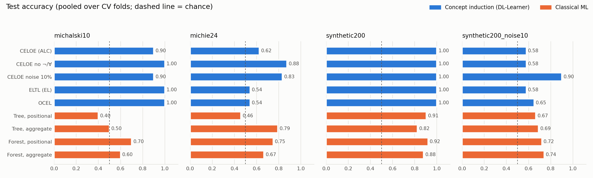
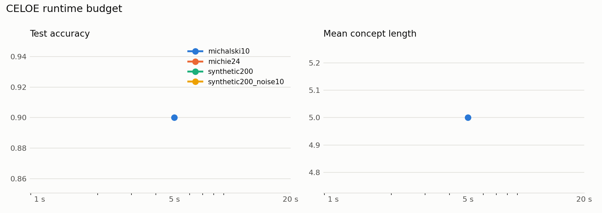

# 1. Introduction

Concept induction learns a class expression *C* from a knowledge base
𝒪 = (𝒯, 𝒜) and example sets *P*, *N* such that
𝒪 ⊨ C(a) for every a ∈ P and 𝒪 ⊭ C(b) for every b ∈ N.
We apply DL-Learner [1] to the UCI *Trains* data [2], a small but genuinely
**relational** benchmark. We compare it with decision trees and random forests,
and we ask what the logical representation buys us.

**Main findings.**

1. When the target is an existential pattern over parts ("some wagon is short and
   closed"), DL-Learner recovers it **exactly** from 10 trains: leave-one-out
   accuracy 0.90–1.00, against 0.40–0.70 for trees and forests. On 200 synthetic
   trains it reaches 1.00, against at most 0.92.
2. With label noise, DL-Learner's noise parameter is decisive. Without it, CELOE
   overfits (0.58). With `noisePercentage=10` it returns the **true** concept, scoring 1.00
   against the clean labels, where the best forest scores 0.84.
3. On Michie's harder 24-train problem, a *restricted* hypothesis language (no ¬/∀)
   reaches 0.875, beating all baselines (best 0.79). Its official rule needs "two
   adjacent wagons with the **same** load shape". That kind of variable binding is
   outside ALC, and no setting finds it.
4. Under the open-world assumption with HermiT, each reasoning step is 1–3 orders of
   magnitude slower. With 5 s the search fails (⊤). With 60 s it recovers the same
   existential concept (0.90), since ∃-concepts mean the same under both
   assumptions, whereas ∀/¬ concepts need closure axioms.

# 2. Dataset

**Source.** UCI ML Repository #103 *Trains* (Michalski & Larson 1977; Stepp & Michalski 1986).
Each train pulls 2–4 wagons behind an engine. Each wagon has a *shape* (10 values,
e.g. open rectangle, U-shaped, hexagon, jagged top), a *length* (short/long), 2 or 3
*wheels*, and carries 0–3 *loads* of one shape (circle, triangle, rectangle,
hexagon). Wagons are ordered (`infront`). The UCI documentation also gives a
hierarchy: four shapes are *open-top* and the others are *closed-top*.

We use three learning sets (Table 1):

| set | trains | pos / neg | wagons | target | source |
|---|---|---|---|---|---|
| **michalski10** | 10 | 5 / 5 | 30 | eastbound | `trains-original.data` |
| **michie24** | 24 | 12 / 12 | 82 | "OK" | `trains.supplement` (Michie's 1994 challenge) |
| **synthetic200** | 200 | 100 / 100 | 621 | eastbound | generated, hidden rule |
| **synthetic200_noise10** | 200 | 94 / 106 | 621 | eastbound | same, 10 % labels flipped |

*Table 1 – learning sets.*

The UCI page contains only 10 trains, too few to estimate test performance.
Two extra sources make the evaluation meaningful:

* **Michie's 24 trains**, from the supplement file shipped with the UCI dataset.
  They use a richer vocabulary: roof type (none/flat/peaked/jagged/arc), double walls, and diamond and inverted-triangle loads.
  The challenge's "official" rule is relational: *a wagon with a peaked roof, or two
  **adjacent** short wagons with the **same** load shape*.
* **200 synthetic trains**, drawn at random in Michalski's vocabulary (seed 42) and
  labelled by Michalski's classic answer, *"has a short closed wagon"*. The classes
  are balanced by rejection sampling. Since the true concept is known, we can
  check whether the learner **recovers** it, and how label noise affects it.

**Why this dataset suits concept induction.** A train is not a fixed-length
row. UCI's own "transformed" version must invent the columns `car2_shape … car5_shape`
and pad missing wagons with "-". A rule like "*some* wagon is short and
closed" becomes, for a propositional learner, a disjunction over wagon positions.
For a DL learner it is the single existential restriction ∃hasCar.(Short ⊓ Closed).

**Checks.** After parsing (`src/parse_data.py`), the Michalski labels agree 10/10
with the classic rule, and Michie's labels agree 24/24 with the published official rule.

# 3. Knowledge base

`src/build_ontology.py` converts each set into an OWL ontology (RDF/XML,
`ontology/*.owl`).

**Individuals.** One per train, wagon and load. For example, michalski10 has
10 trains, 30 wagons and 35 loads, so 75 individuals. synthetic200 has 1,603.

**TBox (classes).**

* `Train`, `Car`, `Load`: pairwise disjoint.
* `ShortCar` / `LongCar`, `OpenCar` / `ClosedCar`, `TwoWheelCar` / `ThreeWheelCar`:
  each pair is disjoint. These are the categorical and discretised attributes.
* One class per wagon shape, placed under `OpenCar` or `ClosedCar` following the UCI
  hierarchy (e.g. `UShapedCar ⊑ OpenCar`, `JaggedTopCar ⊑ ClosedCar`). The shapes are mutually disjoint.
* Michie only: roof classes (`PeakedRoofCar ⊑ ClosedCar`, `NoRoofCar ⊑ OpenCar`, …)
  and `DoubleWallCar`.
* One class per load shape (`CircleLoad ⊑ Load`, …), mutually disjoint.

**Object properties.** `hasCar` (Train→Car), `hasLoad` (Car→Load), and
`inFrontOf` (Car→Car, functional: the wagon *directly* behind).

**Data properties** (functional, `xsd:integer`). `carCount` (Train), `position`,
`wheels`, `loadCount` (Car). DL-Learner can build datatype restrictions such as
∃carCount.[≥ 3] from these.

**Modelling choices.**

1. *No leakage.* The direction/OK label appears nowhere in the ontology. It only
   appears in the example lists of the `.conf` files.
2. *Engine dropped.* Every Michalski train starts with an identical engine, so it carries no information.
3. *Load shape as a class of a separate load individual*, not as a wagon
   attribute. The ontology therefore keeps the three-level structure
   train → wagon → load (concept depth 3).
4. *Numbers.* `wheels` is both discretised (two classes) and kept as a data
   property. `carCount`, `position` and `loadCount` are data properties only.
5. *No missing values.* A wagon without a load simply has no `hasLoad` filler.
6. *Closure variant.* `ontology/*_closed.owl` adds, for every train,
   `hasCar only {c1,…,cn}`; for every wagon, `hasLoad only {l1,…}` (or `only ⊥`);
   for the last wagon, `inFrontOf only ⊥`; and `AllDifferent` over all
   individuals. With these axioms, ∀- and ¬-statements about the data become
   *entailed* under the open-world assumption (Sections 6.5 and 7.3).

# 4. Learning problem

**Target and examples.** *P* = eastbound (resp. OK) trains and *N* = the others,
using `posNegStandard`. The sets are balanced by construction.

**Splits** (`src/splits.py`, `data/splits/`). Leave-one-out for the 10- and
24-train sets, and stratified 5-fold (seed 0) for the synthetic sets. **The same
folds** are used for DL-Learner and the baselines. Because every LOO test fold holds
one train, we report metrics on the **pooled** test predictions of all folds.

**Evaluation of a concept on test data.** DL-Learner only reports accuracy on
the examples it was given. For each fold we therefore take its best concept (solution #1)
and classify the held-out trains with our own evaluator (`src/dl_concepts.py`).
The evaluator parses DL-Learner's Manchester-style output and implements the
**closed-world semantics of DL-Learner's `closed world reasoner`**:
negation as failure, and ∀ over the asserted fillers. On the full data it reproduces
DL-Learner's reported accuracies exactly (e.g. 100 % for
∃hasCar.(ClosedCar ⊓ ShortCar), 80 % for ∃carCount.[≥3]).

**Hypothesis language.** The reference setting is CELOE with the ρ refinement
operator over **ALC(D) with qualified number restrictions**:
⊤, ⊥, atomic classes, ¬, ⊓, ⊔, ∃r.C, ∀r.C, ≥n r.C, ≤n r.C, and ∃d.[range]
over the integer data properties. We restrict this language in Section 5 (no ¬/∀;
no datatypes/cardinalities; EL only). Inverse roles, nominals and hasValue are off.
**Length** follows DL-Learner's metric: atom = 1, ¬C = 1+|C|, C⊓D = |C|+|D|+1,
∃r.C = 2+|C|, ≥n r.C = 3+|C|, ∃d.range = 3.

# 5. Experimental settings

All runs use DL-Learner 1.5.0 (`tools/dlcli.sh`), positive/negative learning
(`posNegStandard`) and predictive accuracy. Each setting changes **one** parameter
relative to the reference `celoe_alc`. The generated `.conf` files are in
`conf/<setting>/<dataset>/`, and `src/run_experiments.py` regenerates and runs everything.

| setting | algorithm | reasoner | language (ρ operator) | time | noise |
|---|---|---|---|---|---|
| **celoe_alc** (reference) | CELOE | closed world | ALC + ≥/≤ + ∃d.[range] | 5 s | 0 % |
| celoe_no_neg_all | CELOE | closed world | no ¬, no ∀ | 5 s | 0 % |
| celoe_no_data_card | CELOE | closed world | no datatypes, no cardinalities | 5 s | 0 % |
| eltl_el | ELTL | closed world | EL (⊓, ∃ only) | 5 s | 0 % |
| ocel_alc | OCEL | closed world | as reference | 5 s | 0 % |
| celoe_t1 / celoe_t20 | CELOE | closed world | as reference | 1 s / 20 s | 0 % |
| celoe_noise10 | CELOE | closed world | as reference | 5 s | 10 % |
| owa_hermit_open | CELOE | HermiT (OWA) | as reference, open ontology | 5 s | 0 % |
| owa_hermit_closed | CELOE | HermiT (OWA) | as reference, closure ontology | 5 s | 0 % |
| owa_hermit_*_t60 | CELOE | HermiT (OWA) | as above | 60 s | 0 % |

*Table 2 – experimental settings. HermiT settings are run on the two small sets only.*

In total there are 456 + 22 DL-Learner runs (folds plus one full-data run per setting and
dataset), executed 4 in parallel on a laptop (8 cores, 8 GB RAM).
**Baselines** (`src/baselines.py`): CART decision tree and a random forest (200 trees),
both with scikit-learn defaults and `random_state=0`, on two propositionalisations:
*positional* (one column per wagon slot × attribute, like UCI's transformed file)
and *aggregate* (per-train counts of each attribute value, with no conjunctions, so the
target is not handed over).

# 6. Results

Full tables are in `results/summary.md`. Figure 1 compares the main settings.

*Figure 1 – test accuracy (pooled over folds). Blue: DL-Learner; orange: classical ML; dashed: chance.*

## 6.1 Michalski's 10 trains (leave-one-out)

| method | test acc | prec | rec | F1 | length / nodes | time |
|---|---|---|---|---|---|---|
| CELOE (ALC, reference) | 0.90 | 0.83 | 1.00 | 0.91 | 5.0 | 7.6 s |
| CELOE no ¬/∀ | **1.00** | 1.00 | 1.00 | 1.00 | 5.0 | 8.0 s |
| ELTL (EL) | **1.00** | 1.00 | 1.00 | 1.00 | 5.8 | 8.0 s |
| OCEL | **1.00** | 1.00 | 1.00 | 1.00 | 9.0 | 7.7 s |
| HermiT OWA, open / closure (5 s) | 0.80 / 0.50 | | | | 3 / 1 | 8 / 12 s |
| HermiT OWA, open / closure (60 s) | 0.90 / 0.90 | | | 0.91 / 0.91 | 5.0 / 4.6 | 63 / 71 s |
| Decision tree, positional / aggregate | 0.40 / 0.50 | | | 0.25 / 0.62 | 4.8 / 5 nodes | <0.01 s |
| Random forest, positional / aggregate | 0.70 / 0.60 | | | 0.73 / 0.67 | ~1000 nodes | 0.25 s |

On all 10 trains, every closed-world CELOE/ELTL setting returns

Eastbound ≡ ∃hasCar.(ClosedCar ⊓ ShortCar)

("a train goes east iff it has a short, closed wagon"). This is exactly the rule
Michalski reported in 1977, with length 5. The single error of the reference
setting is fold 8 (train I held out). On the remaining 9 trains, CELOE prefers the
equally short but **spurious** ≥3 hasCar.¬JaggedTopCar ("at least 3 non-jagged
wagons"). It fits the 9 training trains perfectly, and it ranks first because
CELOE breaks accuracy ties by length and search order. Removing ¬/∀ (or using EL)
removes this alternative, so the language restriction acts as a useful **bias**.
OCEL also scores 1.00, but it returns a longer, redundant conjunct
(… ⊓ ∃carCount.[≥3], length 9). Unlike CELOE it does not prefer short concepts.

The decision trees are worse than chance on LOO. The full-data positional tree is
"car3_load = none → west; else car4_shape = opentrap → west; else east", which is
consistent with the data and meaningless: with 10 rows and 70 columns,
many positional coincidences separate the classes.

## 6.2 Michie's 24 trains (leave-one-out)

| method | test acc | prec | rec | F1 | mean length | distinct fold concepts |
|---|---|---|---|---|---|---|
| CELOE (ALC, reference) | 0.625 | 0.60 | 0.75 | 0.67 | 7.9 | 7 |
| CELOE no ¬/∀ | **0.875** | 0.91 | 0.83 | **0.87** | 9.0 | 4 |
| CELOE 20 s | **0.875** | 0.91 | 0.83 | **0.87** | 9.0 | 4 |
| CELOE noise 10 % | 0.833 | 0.90 | 0.75 | 0.82 | 9.3 | 6 |
| CELOE 1 s | 0.625 | 0.59 | 0.83 | 0.69 | 7.5 | 5 |
| ELTL (EL) | 0.542 | 0.53 | 0.75 | 0.62 | 11.7 | 6 |
| OCEL | 0.542 | 0.53 | 0.75 | 0.62 | 19.3 | 8 |
| Decision tree, aggregate | 0.792 | 0.82 | 0.75 | 0.78 | 8.8 nodes | – |
| Random forest, positional | 0.750 | 0.71 | 0.83 | 0.77 | ~2660 nodes | – |

This target is harder: no concept reaches 100 % training accuracy within 5 s.
The best concept (no ¬/∀, or 20 s) is

∃hasCar.(DoubleWallCar ⊔ PeakedRoofCar ⊔ (ClosedCar ⊓ RectangleCar))

("some wagon has a double wall, a peaked roof, or is a closed rectangle"). It has 96 %
training accuracy, and 21 of 24 folds return it. Its first two disjuncts (peaked roof,
double wall) are the same conditions used by the human entries of Pennifold and Shaw
in Michie's competition, and the peaked roof is half of the official rule. The official rule is *peaked roof ∨ two adjacent short wagons with the
same load shape*. Its second part needs a **co-reference** between the loads
of two wagons (the same shape *X*), which ALC/EL cannot express with one
existential. It could only be written as a 6-way disjunction over the load shapes,
⊔ₓ ∃hasCar.(ShortCar ⊓ ∃hasLoad.X ⊓ ∃inFrontOf.(ShortCar ⊓ ∃hasLoad.X)), of length
well over 60, far beyond what the search reaches. ELTL comes closest structurally
(∃hasCar.(ShortCar ⊓ ∃inFrontOf.ShortCar) appears in its concept) but overfits.

With the full ALC language, 6 of 24 folds return ∀hasCar.(ClosedCar ⊔ ShortCar)
("no wagon is long and open"). It is correct on most training trains, but it is a
closed-world artefact (Section 7.3) and generalises poorly. With only 23 training examples,
**a larger hypothesis space produces more spurious, equally accurate concepts**, and
test accuracy falls from 0.875 to 0.625. Here the aggregate decision tree is a strong
competitor (0.79). Its top split is *n_roof=peaked*, the same key feature.

## 6.3 Synthetic trains (stratified 5-fold, 200 trains)

**Clean labels.** All eight closed-world DL settings return
∃hasCar.(ClosedCar ⊓ ShortCar) in every fold: the hidden rule is
recovered exactly, with test accuracy 1.00. The best baseline (forest, positional) reaches
0.92 with ~14,000 tree nodes. The single positional tree needs 45 nodes and depth 8 to
approximate the rule slot by slot (*car4 short? car2 closed? …*). Search effort
is small: CELOE tests only ≈1,000 candidates in 1 s and still finds the concept.

**10 % label noise** (accuracy against the noisy test labels; the ceiling is ≈0.90):

| method | test acc (noisy) | acc vs **true** labels | concept on all data |
|---|---|---|---|
| CELOE, noise 0 (reference) | 0.58 | 0.65 | ∃hasCar.ClosedCar ⊓ ∃hasCar.TwoWheelCar |
| CELOE, 20 s | 0.60 | 0.68 | same |
| OCEL | 0.65 | 0.71 | ∃hasCar.(ClosedCar ⊓ (ShortCar ⊔ (…))), length 15 |
| **CELOE, noise 10 %** | **0.90** | **1.00** | **∃hasCar.(ClosedCar ⊓ ShortCar)** |
| Random forest, aggregate | 0.74 | 0.84 | – |
| Decision tree, aggregate | 0.69 | 0.74 | – |

With `noisePercentage = 0`, CELOE keeps searching for a concept that covers the
flipped examples. Within the time limit it settles on an over-general
concept with high recall (0.96) and low precision (0.53). Telling the learner to tolerate
10 % noise makes it accept the 90 %-accurate true rule. All 5 folds return the
same concept, and it classifies every test train exactly as the clean
rule does. The trees, which fit the training data perfectly (train acc 1.00),
memorise the noise.

## 6.4 Effect of the runtime budget, search algorithm and language

*Figure 2 – CELOE with 1, 5 and 20 s budgets.*

* **Runtime.** On easy targets (Michalski, synthetic) 1 s is enough: CELOE finds the
  length-5 solution after a few thousand candidates. On Michie, 1 s → 0.625,
  5 s → 0.625, 20 s → 0.875. More search (≈155k candidates) reaches longer
  disjunctive concepts. On noisy data more time does not help without the noise parameter
  (0.58 → 0.60).
* **Heuristic.** CELOE's length-penalised heuristic gives short concepts. OCEL
  returns longer ones (mean length 9–19) and, with noise 0, it reports *no* solution
  unless one is 100 % accurate. In 31 runs (Michie and noisy) we used its best
  partial concept.
* **Language.** Removing ¬/∀ never hurt and helped on Michie (+25 points).
  Removing datatypes/cardinalities changed little (+4 points on Michie).
  EL (ELTL) is fine for purely existential targets but cannot express the
  disjunction needed for Michie.

## 6.5 Open-world reasoning (HermiT)

| setting (michalski10) | test acc | train acc | candidates tested | concept on all data |
|---|---|---|---|---|
| closed-world reasoner, 5 s (reference) | 0.90 | 1.00 | 25,491 | ∃hasCar.(ClosedCar ⊓ ShortCar) |
| HermiT, open ontology, 5 s | 0.80 | 0.80 | 135 | ∃carCount.[≥3] |
| HermiT, closure ontology, 5 s | 0.50 | 0.50 | 16 | ⊤ |
| HermiT, open ontology, 60 s | 0.90 | 0.99 | 4,062 | ∃hasCar.(ClosedCar ⊓ ShortCar) |
| HermiT, closure ontology, 60 s | 0.90 | 0.97 | 304 | ∃hasCar.(ClosedCar ⊓ ShortCar) |

On Michie's 24 trains, both HermiT settings return ⊤ within 5 s (5–17 candidates
tested). With a 60 s budget, OWA learning on Michalski's trains recovers the same concept
in 9 of 11 runs, so the target is learnable under the OWA, because it is purely
existential. The cost is 12–14× more wall time per fold for a search that is still
6–80× smaller. One OWA run on the open ontology again returns ≥3 hasCar.¬JaggedTopCar.
This is interesting because, without the unique-name assumption, "at least 3 wagons" is only entailed when
the wagons are *provably distinct*. Here that follows from their disjoint asserted
classes (different shapes or lengths), and ¬JaggedTopCar follows from the
shape-disjointness axioms. So our disjointness axioms already act as a partial closure.

# 7. Discussion

## 7.1 Interpretability: would a domain expert accept the concepts?

The DL concepts are short (length 5–9), read naturally in English, and are stated
over the **objects of the domain** (trains, wagons, loads), not over column
positions. "A train has a short closed wagon" and "some wagon has a peaked roof
or a double wall" are the rules humans wrote in the original competitions. The
decision trees are either brittle (positional splits such as "car 3 has no load")
or opaque (forests with thousands of nodes). The aggregate tree on Michie is the
exception: it is readable, but it uses counts ("≥3 rectangular wagons") rather than
a description of a single wagon.

## 7.2 Trivial, spurious and overly long solutions

* **Trivial:** ⊤ or `Train` (50 %) is returned only when the search fails
  (HermiT at 5 s).
* **Spurious:** ≥3 hasCar.¬JaggedTopCar (Michalski fold 8), ∀hasCar.(Closed ⊔ Short)
  (Michie), and ∃hasCar.ClosedCar ⊓ ∃hasCar.TwoWheelCar (noisy data). Each is short and
  fits the training set, but it exploits accidents of a small or noisy sample. The
  number of *distinct* concepts over folds is a cheap indicator: 1–2 for the
  stable problems, 5–8 for Michie with the full language.
* **Overly long / redundant:** OCEL's … ⊓ ∃carCount.[≥3] (Michalski) and
  its length-19 concepts on Michie. Among the lower-ranked CELOE solutions there are also many
  logically redundant variants (¬LongCar ⊓ ∃hasCar.(…), since a train is never a car).

## 7.3 Open vs closed world

DL-Learner's *closed world reasoner* materialises the ABox and applies negation as
failure: ∀hasCar.C holds if all **known** wagons are in C, and ¬ShortCar holds for
anything not asserted short. Under the OWA (HermiT), a train is an instance of
∀hasCar.C only if the ontology **entails** that it has no other wagons. Without
closure axioms this is never the case, so concepts such as ∀hasCar.(ClosedCar ⊔ ShortCar)
cover no example. Negation is only entailed through our disjointness
axioms (e.g. LongCar ⊑ ¬ShortCar). The existential concept ∃hasCar.(ClosedCar ⊓
ShortCar) has the **same** extension under both semantics, which is why the main result does not
depend on the closure assumption. To make OWA reasoning match the closed-world
reading we built `*_closed.owl`, with `hasCar only {c1,…,cn}` per train,
`hasLoad only {…}` per wagon, and `AllDifferent`. This makes ∀/¬ entailed, but
reasoning with these nominals is very slow. On the full Michalski set, one instance
retrieval costs < 1 ms with the closed-world reasoner, 14 ms with HermiT on the open
ontology, and 212 ms with HermiT on the closure ontology. In 5 s CELOE therefore tests
20,872, 167 and 14 candidate concepts, respectively.

**Closure assumptions we made:** (i) DL-Learner's closed-world reasoner (closed-world
semantics) for all main experiments; (ii) disjointness of sibling classes (in both
ontologies); (iii) explicit closure axioms in the `_closed` ontologies only.

## 7.4 What symbolic learning gave us that the baseline did not, and vice versa

**Concept induction gave:**

* **The relational bias for free.** "Some part has property P" is one ∃
  restriction, whatever the number or order of wagons. A propositional learner must either
  enumerate positions (positional encoding, which needs many examples) or rely on
  hand-designed aggregates.
* **Data efficiency.** It recovers the true rule from 9 examples, where trees are at chance.
* **Exact, verifiable models** that coincide with the rules humans wrote, and that
  can be checked against background knowledge (the open/closed hierarchy is used
  directly as `ClosedCar`).
* **A controllable bias:** language restrictions and the noise parameter mattered more
  than raw search time.

**The baselines gave:**

* **Speed and robustness:** training in milliseconds versus 5–20 s per fold, and
  no tuning. On noisy data with the wrong noise setting, the forests beat CELOE.
* **Graded predictions and no hard expressivity wall:** a forest can approximate
  any decision boundary, given enough data. DL-Learner fails outright when the target is outside the
  language (Michie's co-reference rule) or when the reasoner is slow (OWA).
* **No need to know the noise level** in advance. CELOE needed the correct
  `noisePercentage` to shine.

## 7.5 Limitations

* The real datasets are tiny (10 and 24 trains). LOO estimates have large variance:
  one train = 10 or 4 accuracy points. The synthetic study helps, but its target is,
  by construction, expressible in the hypothesis language.
* Test-set classification uses our closed-world evaluator. It matches the reasoner
  used for learning in all closed-world settings, but for HermiT runs it
  evaluates the learned concept under closed-world semantics.
* We tested one noise level (10 %) and tuned no baseline hyper-parameters.
* Each setting was run once. DL-Learner's search is deterministic for a given
  configuration, but the runtime limit makes the result machine-dependent.

# 8. Conclusion

On the Trains problem, concept induction in description logics does what a
propositional learner cannot. From ten examples it recovers the classic,
human-readable rule ∃hasCar.(ClosedCar ⊓ ShortCar), and on 200 noisy trains it
recovers the hidden rule exactly once told the noise level. Its weaknesses are just as clear:
the result depends on the hypothesis-language bias (a richer language overfits small
samples), on knowing the noise level, on the closed-world assumption for ∀/¬, and on
the target being expressible in the logic at all (Michie's "same load shape"
rule is not).

# Contributions of each member

**Khazar Mammadov.** Khazar built the symbolic side of the pipeline: parsing the
UCI Trains files and Michie's 24-train challenge into a common relational format,
generating the synthetic and noisy trains, and checking the parsed labels against the
published rules. Khazar designed the OWL ontology (class hierarchy, object and data
properties, the closure-axiom variant), set up DL-Learner, wrote the experiment
runner that generates the `.conf` files for every setting and fold, wrote the
closed-world evaluator that scores learned concepts on held-out trains, and ran the
open-world (HermiT) experiments.

**Turan Abbasli.** Turan built the comparison and the analysis, implementing the
decision-tree and random-forest baselines on the positional and aggregate encodings,
using the same folds as DL-Learner, and writing the evaluation script that pools the
metrics and produces the tables and figures. Turan analysed the learned concepts (which
are meaningful, spurious, trivial or overly long), compared performance and
interpretability with the baselines, and led the writing of the report and the
presentation.

**Both.** We chose the dataset and the learning problems together, and discussed the
interpretation of the results, in particular the open- vs closed-world behaviour and
the limits of the hypothesis language.

# References

1. J. Lehmann. DL-Learner: Learning Concepts in Description Logics. *JMLR* 10, 2009;
   J. Lehmann et al. Class expression learning for ontology engineering (CELOE). *J. Web Semantics* 9(1), 2011.
2. R.S. Michalski, J.B. Larson. Inductive inference of VL decision rules. *SIGART Newsletter* 63, 1977. UCI ML Repository, *Trains* dataset (id 103).
3. D. Michie, S. Muggleton, D. Page, A. Srinivasan. To the international computing community: a new East-West challenge. Oxford University Computing Laboratory, 1994.
4. J. Lehmann, P. Hitzler. Concept learning in description logics using refinement operators. *Machine Learning* 78, 2010.
